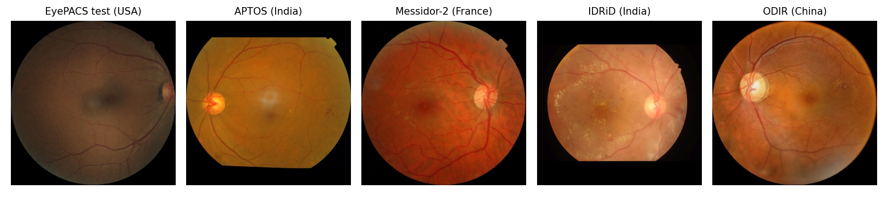
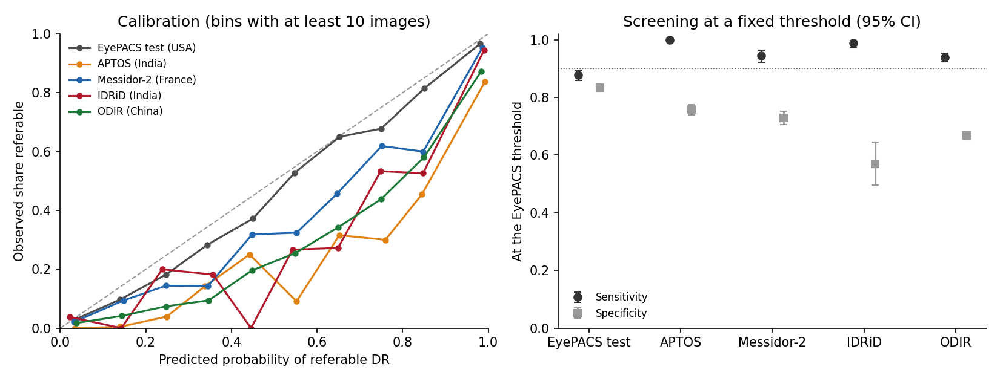
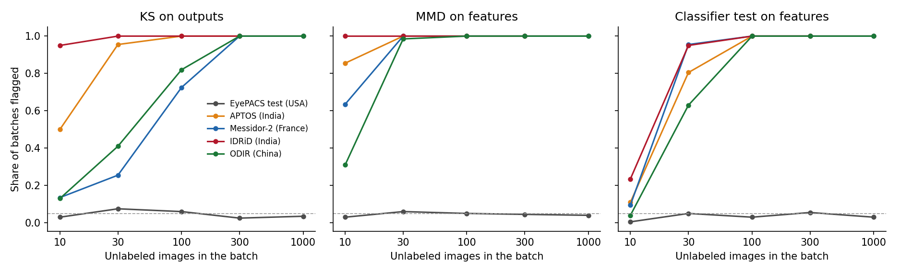
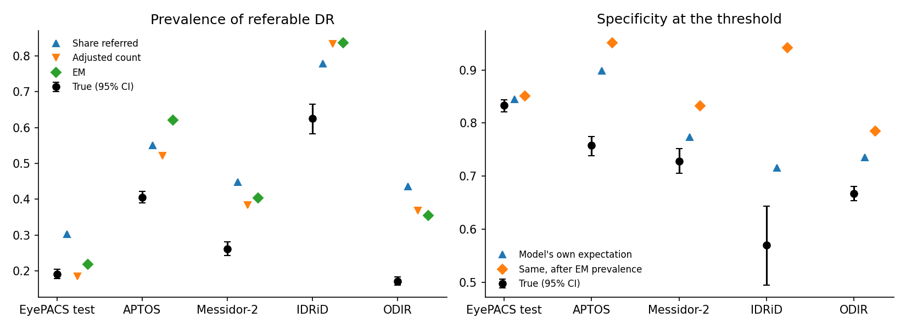
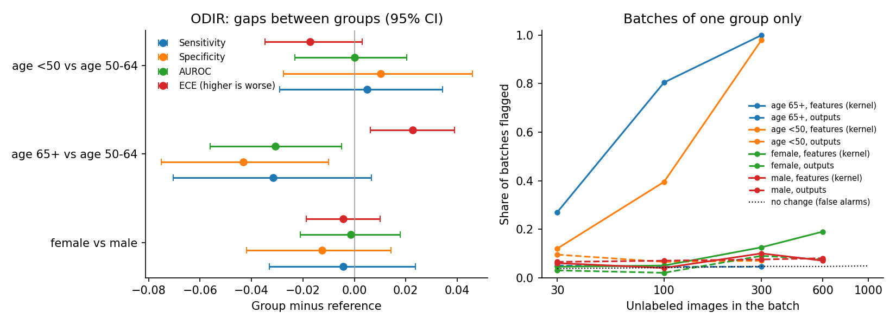
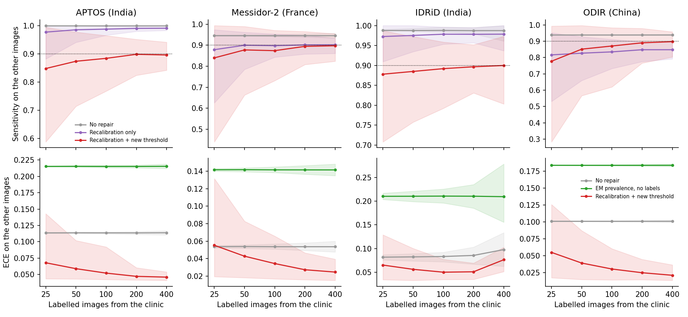

# A diabetic retinopathy screening model at clinics it never saw

When a retinal screening model trained at one clinic network is used somewhere else, what breaks, can it be noticed without labels, and how few labelled images does it take to repair?

This repository studies that question with a referable diabetic retinopathy classifier trained on EyePACS (USA) and used, unchanged, on four public datasets from other clinics and countries: APTOS (India), Messidor-2 (France), IDRiD (India) and ODIR (China). It covers:

- **What changes at a new clinic:** ranking, sensitivity and specificity at a fixed screening threshold, and calibration (E1).
- **Noticing the change without labels:** how many unlabeled images three shift tests need to flag a new clinic, and how often they raise false alarms (E2).
- **Estimating performance without labels:** whether the model's own outputs tell how well it does at a new clinic (E3).
- **A pure population shift inside one site:** gaps by sex and age within ODIR, and whether batches of a single group are flagged (E4).
- **Repair with a few labels:** recalibration and a new threshold fitted on 25–400 labelled images from the new clinic, against doing nothing and against a repair that needs no labels (E5).

Confidence intervals are 95% intervals from a bootstrap with 1,000 resamples, resampling patients where the dataset identifies them (EyePACS, ODIR) and images otherwise. Differences between a clinic and EyePACS test resample both independently.

This is the third study in a series with [missing-pieces-ecg](https://github.com/sabaso94/missing-pieces-ecg) (a deep ECG classifier on PTB-XL with missing leads, subgroups and shift) and [missing-pieces-wearable](https://github.com/sabaso94/missing-pieces-wearable) (mortality risk from a wrist wearable and clinical data when parts are missing).

## Motivation

Diabetic retinopathy screening is one of the few places where image classifiers already run in clinics, and a model is rarely used where it was trained. Cameras, the population, the share of patients with disease and the way graders label images all change from one clinic to the next. A screening programme cares about one operating point, a referral threshold set for high sensitivity, and about whether predicted risks can be read at face value.

Koch et al. (2024) compared shift tests for a diabetic retinopathy model on shifts simulated within one large retinal dataset (changing the share of patients by sex, ethnicity, co-morbidity or image quality) and found classifier-based tests the most sensitive. The ECG study likewise built its shifts from subgroups of one dataset. This study moves to real clinics, where the shift is whatever really differs between sites, and asks the questions a screening programme would ask:

- Does the model still catch referable disease at the threshold it was validated with, and at what cost in unnecessary referrals?
- Do shift tests on unlabeled images notice the new clinic, and from how many images? Besides the output and feature tests of the ECG study, a classifier two-sample test is added.
- Can the model's own outputs say how well it does there, or is a small labelled sample needed? And if so, how small?

## Data and setup

| Site | Country | Images | Patients | Referable | Grades | Kaggle copy used | Licence on Kaggle |
|---|---|---|---|---|---|---|---|
| EyePACS | USA | 35,126 | 17,563 | 19.6% | ICDR 0–4, one grade per image | `tanlikesmath/diabetic-retinopathy-resized` (Kaggle 2015 competition, resized) | not stated |
| APTOS 2019 | India | 3,662 | not given | 40.6% | ICDR 0–4 | `mariaherrerot/aptos2019` (train, validation and test of the 2019 competition) | not stated |
| Messidor-2 | France | 1,744 gradable | not given | 26.2% | ICDR 0–4, adjudicated (Krause et al., 2018); images from Decencière et al. (2014) and Abràmoff et al. (2013) | `mariaherrerot/messidor2preprocess` and `google-brain/messidor2-dr-grades` | not stated; grades CC0 |
| IDRiD | India | 516 | not given | 62.6% | ICDR 0–4 | `aaryapatel98/indian-diabetic-retinopathy-image-dataset` (grading set; Porwal et al., 2018) | CC BY 4.0 |
| ODIR-5K | China | 6,939 eyes | 3,475 | 17.2% | from free-text findings per eye (below) | `andrewmvd/ocular-disease-recognition-odir5k` (Li et al., 2021) | other |

| | |
|---|---|
| Outcome | Referable diabetic retinopathy: ICDR grade 2 or worse (Wilkinson et al., 2003), moderate non-proliferative or worse, the usual screening target (Gulshan et al., 2016; Krause et al., 2018) |
| Preprocessing | Every image is cropped to the fundus disc, padded to a square and resized to 384 × 384 px, the same way at every site. Colour is not normalised: it is part of what differs between cameras. |
| ODIR labels | ODIR gives free-text findings per eye. Graded keywords (mild, moderate, severe non-proliferative, proliferative) map to ICDR grades; eyes with only other findings count as non-referable. 61 eyes with "diabetic retinopathy" without a grade, or only a suspected one, are excluded. |
| EyePACS split | By patient: 24,590 training, 3,512 validation and 7,024 test images. The other four sites are used only for testing. |
| Model | ResNet-50 (He et al., 2016; ImageNet weights), one output; AdamW, cosine schedule, at most 15 epochs with early stopping on validation AUROC; flips, rotations of up to 15° and ±10% brightness and contrast. Five seeds; the prediction is the mean of the five. Validation AUROC 0.946 (single models 0.931–0.937). |
| Screening threshold | Set once on EyePACS validation for 90% sensitivity (probability 0.151; validation specificity 0.834) and used unchanged at every site |
| Metrics | AUROC; sensitivity and specificity at the threshold; expected calibration error (ECE, 15 bins); calibration-in-the-large (Van Calster et al., 2019) (CITL, mean prediction minus observed share; > 0 means the model over-predicts); calibration slope (< 1 means predictions are too extreme); Brier score |



## Results

### E1: what changes at a new clinic

| Site | AUROC | Sensitivity | Specificity | ECE | CITL | Calibration slope |
|---|---|---|---|---|---|---|
| EyePACS test | 0.933 [0.923, 0.942] | 0.878 [0.858, 0.894] | 0.833 [0.821, 0.844] | 0.019 | +0.018 | 0.94 [0.88, 1.01] |
| APTOS | 0.961 [0.955, 0.967] | 1.000 [1.000, 1.000] | 0.758 [0.739, 0.775] | 0.114 | +0.114 | 0.54 [0.51, 0.58] |
| Messidor-2 | 0.952 [0.941, 0.963] | 0.945 [0.922, 0.964] | 0.728 [0.705, 0.752] | 0.054 | +0.054 | 0.85 [0.76, 0.95] |
| IDRiD | 0.971 [0.957, 0.982] | 0.988 [0.973, 0.997] | 0.570 [0.495, 0.644] | 0.081 | +0.075 | 0.78 [0.66, 0.97] |
| ODIR | 0.931 [0.920, 0.940] | 0.938 [0.923, 0.952] | 0.667 [0.653, 0.681] | 0.101 | +0.101 | 0.78 [0.73, 0.84] |



- **Ranking survives.** AUROC is 0.931–0.971 at the new clinics, no lower than on EyePACS test (ODIR −0.002 [−0.016, 0.012]; the others higher). AUROC depends on the mix of cases and on how the labels were made, so a higher value elsewhere is not a sign the model works better there.
- **Referable disease is still caught.** At the EyePACS threshold, sensitivity is 0.938–1.000 at every new clinic, higher than on EyePACS test.
- **The cost is unnecessary referrals.** Specificity falls at every new clinic, by 0.076 [0.055, 0.095] at APTOS, 0.105 [0.078, 0.131] at Messidor-2, 0.166 [0.147, 0.184] at ODIR and 0.263 [0.190, 0.335] at IDRiD. At ODIR, one in three eyes without referable disease would be referred.
- **Risk is over-predicted everywhere.** Mean predicted risk exceeds the observed share of referable eyes at all four clinics (CITL +0.054 to +0.114), and predictions are too extreme (slopes 0.54–0.85). ECE rises from 0.019 to 0.054–0.114. Read at face value, the model's risks would overstate disease at every new clinic.

Shift here costs specificity and calibration, not sensitivity: the model errs on the side of referral. That is the safer direction for a screening programme, but at a new clinic it would fill specialist clinics with healthy eyes, and nobody would know how many without grading a sample.

### E2: noticing a new clinic without labels

A batch of *n* unlabeled images arrives from a clinic. Is it different from what the model was validated on? The reference is EyePACS validation (3,512 images). Three tests, each at a 5% level:

- **Outputs:** a Kolmogorov–Smirnov test on the predicted probabilities (BBSD, Rabanser et al., 2019).
- **Features, kernel test:** MMD (Gretton et al., 2012) on the network's internal features (one ensemble member, reduced to 32 dimensions by a PCA fitted on EyePACS training images), with 200 permutations.
- **Features, classifier test:** a logistic regression fitted to tell batch images from an equal number of reference images on a random half of both, and scored on the other half; under no shift, its correct calls are binomial (Lopez-Paz & Oquab, 2017). Koch et al. (2024) found this kind of test the most sensitive on simulated retinal shifts.

Batches of 10 to 1,000 images are drawn without replacement, 200 times per size, from EyePACS test (where every alarm is a false one) and from each new clinic.

| Pool | Test | 10 images | 30 | 100 | 300 |
|---|---|---|---|---|---|
| EyePACS test (false alarms) | outputs / kernel / classifier | 0.03 / 0.03 / 0.01 | 0.08 / 0.06 / 0.05 | 0.06 / 0.05 / 0.03 | 0.03 / 0.05 / 0.06 |
| APTOS | outputs / kernel / classifier | 0.50 / 0.86 / 0.11 | 0.96 / 1.00 / 0.81 | 1.00 / 1.00 / 1.00 | 1.00 / 1.00 / 1.00 |
| Messidor-2 | outputs / kernel / classifier | 0.14 / 0.64 / 0.10 | 0.26 / 1.00 / 0.96 | 0.73 / 1.00 / 1.00 | 1.00 / 1.00 / 1.00 |
| IDRiD | outputs / kernel / classifier | 0.95 / 1.00 / 0.24 | 1.00 / 1.00 / 0.95 | 1.00 / 1.00 / 1.00 | 1.00 / 1.00 / 1.00 |
| ODIR | outputs / kernel / classifier | 0.13 / 0.31 / 0.04 | 0.41 / 0.99 / 0.63 | 0.82 / 1.00 / 1.00 | 1.00 / 1.00 / 1.00 |



- **False alarms stay at the nominal level:** 0.5–7.5% of EyePACS test batches are flagged, for every test and batch size up to 1,000.
- **Every new clinic is noticed from a few dozen images.** The kernel test on features flags 99–100% of batches of 30 images from every clinic, and already 64–100% of batches of 10 at APTOS, Messidor-2 and IDRiD. With 100 images both feature tests flag every batch from every clinic.
- **The outputs alone are slower.** At Messidor-2 and ODIR, where the share of referable eyes is close to EyePACS, the output test needs 300 images to flag every batch (26% and 41% of batches of 30). The images look different to the network before its predictions do.
- **The classifier test needs more images than the kernel test here.** It fits on half of each batch and scores the other half, so at 10 images it has 10 to score and rarely flags anything (4–24%); from 100 images it flags every batch. Real clinics differ in camera and population at once, a large shift that the kernel test already catches; the classifier test's advantage in Koch et al. (2024) was on subtle subgroup shifts (E4 looks at one).
- **An alarm does not say how much harm.** ODIR is the slowest clinic to be flagged, yet it has the second-largest loss of specificity (E1); APTOS is among the quickest, with the smallest loss. A shift test says *that* something changed; E3 and E5 ask what it costs.

### E3: estimating performance without labels

Without labels, the model's outputs are all there is. Estimates of each site's prevalence, sensitivity, specificity and accuracy, from the outputs alone:

- **Prevalence:** the share of images referred (classify and count); the same corrected for EyePACS validation sensitivity and specificity (adjusted count, Forman, 2008); and EM re-estimation of the prevalence (Saerens et al., 2002).
- **Sensitivity and specificity:** the model's own expectation, treating each prediction as the true probability of referable disease, with and without the EM prevalence correction.
- **Accuracy at the threshold:** the same expectation; ATC (Garg et al., 2022), the share of images above a confidence threshold fitted on EyePACS validation; and DoC (Guillory et al., 2021), validation accuracy shifted by the change in average confidence.

| Site | Prevalence: true | adjusted count | EM | Specificity: true | model's expectation | Accuracy: true | ATC |
|---|---|---|---|---|---|---|---|
| EyePACS test | 0.192 | 0.186 | 0.219 | 0.833 | 0.845 | 0.842 | 0.847 |
| APTOS | 0.406 | 0.522 | 0.621 | 0.758 | 0.899 | 0.856 | 0.948 |
| Messidor-2 | 0.262 | 0.384 | 0.404 | 0.728 | 0.773 | 0.785 | 0.813 |
| IDRiD | 0.626 | 0.834 | 0.836 | 0.570 | 0.716 | 0.831 | 0.913 |
| ODIR | 0.172 | 0.368 | 0.355 | 0.667 | 0.736 | 0.714 | 0.758 |



- **Every estimate is too optimistic, at every new clinic.** Prevalence is overestimated by 0.16–0.19 on average (up to 0.27), specificity by 0.10 (up to 0.15, at IDRiD) and accuracy by about 0.06 for all three accuracy estimators. On EyePACS test the same estimates are close (adjusted count 0.186 against 0.192).
- **The cause is the calibration shift of E1.** Each estimator trusts the model's probabilities, and at the new clinics those overstate disease, so the model believes many of its extra referrals are justified.
- **The ordering of these four clinics is right.** For the plain estimates, it matches the true order (Spearman 1.0 for prevalence, specificity and all three accuracy estimates). With four clinics this is descriptive only: their prevalences are far apart, which makes ordering easy, and a perfect order would arise by chance once in 24 times.
- **Correcting the prevalence with EM makes things worse.** Specificity after the EM correction is overestimated by 0.20 on average (0.37 at IDRiD), and its ranking of the clinics is wrong (Spearman 0.4). EM inherits the over-prediction: its prevalence estimates are as inflated as the others.

The sensitivity estimates are close (mean error −0.02 without EM), but only because the true sensitivity is near 1 at every clinic.

### E4: a population shift inside ODIR

ODIR is the one site that records each patient's age and sex. Within it, two questions:

- **Gaps:** is the model equally good for women and men, and across age bands (<50, 50–64, 65+)? Intervals resample patients.
- **Group-mix shift:** if a clinic's patients become older, younger or more of one sex, do the shift tests notice? ODIR is compared with ODIR, so only the mix of patients changes. Both eyes of a patient look alike, while the tests assume independent images, so in every repetition one eye per patient is taken at random and the patients are split afresh in half within each sex and age band. One half is the reference; the batch is drawn from the other. A batch has a dose of one group on top of its natural share: at dose 0 the group makes up its natural share of the batch, at dose 100% the whole batch, at 50% halfway between (for patients aged 65+, natural share 29%, that is 65%).

| Group | Eyes | Referable | AUROC | Sensitivity | Specificity | ECE |
|---|---|---|---|---|---|---|
| Women | 3,208 | 16.9% | 0.930 [0.916, 0.945] | 0.936 [0.913, 0.957] | 0.660 [0.640, 0.680] | 0.098 |
| Men | 3,731 | 17.4% | 0.931 [0.918, 0.943] | 0.940 [0.921, 0.957] | 0.673 [0.654, 0.691] | 0.103 |
| Age <50 | 1,474 | 19.9% | 0.938 [0.919, 0.956] | 0.949 [0.922, 0.974] | 0.688 [0.657, 0.717] | 0.080 |
| Age 50–64 | 3,440 | 18.1% | 0.938 [0.926, 0.950] | 0.944 [0.924, 0.961] | 0.678 [0.660, 0.698] | 0.098 |
| Age 65+ | 2,025 | 13.5% | 0.907 [0.883, 0.930] | 0.912 [0.875, 0.945] | 0.635 [0.609, 0.661] | 0.120 |

With no change (dose 0), 0–9% of batches are flagged, for every test, group and batch size from 30 to 1,000. Share of batches flagged when the batch is made only of one group (dose 100%):

| Batch | Test | 30 images | 100 | 300 | 600 |
|---|---|---|---|---|---|
| Only age 65+ | outputs / kernel / classifier | 0.05 / 0.27 / 0.07 | 0.04 / 0.81 / 0.26 | 0.04 / 1.00 / 0.73 | – |
| Only age <50 | outputs / kernel / classifier | 0.10 / 0.12 / 0.06 | 0.07 / 0.40 / 0.20 | 0.07 / 0.98 / 0.58 | – |
| Only women | outputs / kernel / classifier | 0.03 / 0.04 / 0.04 | 0.02 / 0.05 / 0.04 | 0.09 / 0.12 / 0.08 | 0.07 / 0.19 / 0.07 |
| Only men | outputs / kernel / classifier | 0.07 / 0.06 / 0.01 | 0.07 / 0.04 / 0.03 | 0.07 / 0.10 / 0.07 | 0.08 / 0.07 / 0.07 |

The pool half holds about 507 eyes of patients aged 65+ and 370 of patients under 50, so batches of only those groups stop at 300.



- **No gap by sex.** Every difference between women and men is small and its interval contains zero (AUROC −0.001 [−0.021, 0.018], sensitivity −0.004 [−0.033, 0.024], specificity −0.013 [−0.042, 0.014]).
- **Patients aged 65+ are served worse.** Against 50–64, AUROC is lower by 0.031 [0.005, 0.056], specificity by 0.043 [0.010, 0.075], and calibration error is higher by 0.023 [0.006, 0.039]; sensitivity is lower by 0.032 [−0.007, 0.071]. Patients under 50 do as well as those aged 50–64.
- **The older clinic is visible in the features, not in the outputs.** Batches of only patients aged 65+ are flagged by the kernel test in 81% of cases at 100 images and in every case at 300; the output test flags at most 7% at any dose and size, so the predicted probabilities barely move although the model does worse on these patients. At a 50% dose (65% of the batch aged 65+), the kernel test flags 57% of batches of 300 and 87% of batches of 600.
- **A change in sex mix is almost invisible.** Batches made only of women are flagged in at most 19% of cases at 600 images, only of men in at most 10%, as Koch et al. (2022) found for subgroup shifts in retinal images. Here this matters little, since the model shows no sex gap.
- As in E2, the classifier test needs more images than the kernel test (73% against 100% for 65+ at 300).

### E5: repair with a few labelled images

Grading a few hundred images at a new clinic is feasible. With *n* labelled images (25–400), drawn at random 200 times per *n*, each repair is fitted on them and scored on the clinic's other images:

- **Recalibration:** Platt scaling (Platt, 1999), a logistic regression on the model's logit (with a weak penalty on the slope, since small samples are often perfectly separated), so that probabilities match the clinic; the threshold stays where EyePACS put it.
- **New threshold:** the threshold that gives 90% sensitivity on the labelled images.
- **Both:** recalibration and a new threshold (the referrals are those of the new threshold; the calibration is Platt's).
- **EM prevalence, no labels:** probabilities adjusted to the prevalence estimated by EM on all of the clinic's images. This is a calibration repair: it changes every probability in the same order, so with a matching threshold the referrals stay those of no repair. It is judged on calibration only.

Mean over the 200 draws, with the 2.5–97.5% range across draws:

| Site | Repair | Labelled | Sensitivity | Specificity | ECE |
|---|---|---|---|---|---|
| APTOS | none | – | 1.000 | 0.758 | 0.114 |
| | recalibration + new threshold | 100 | 0.884 [0.768, 0.964] | 0.906 [0.873, 0.939] | 0.052 [0.042, 0.092] |
| | recalibration + new threshold | 400 | 0.896 [0.842, 0.941] | 0.903 [0.888, 0.919] | 0.046 [0.041, 0.054] |
| | EM prevalence | 0 | – | – | 0.215 |
| Messidor-2 | none | – | 0.945 | 0.728 | 0.054 |
| | recalibration + new threshold | 100 | 0.874 [0.731, 0.970] | 0.853 [0.643, 0.971] | 0.034 [0.017, 0.066] |
| | recalibration + new threshold | 400 | 0.897 [0.824, 0.954] | 0.839 [0.744, 0.928] | 0.025 [0.015, 0.039] |
| | EM prevalence | 0 | – | – | 0.142 |
| IDRiD | none | – | 0.988 | 0.570 | 0.083 |
| | recalibration + new threshold | 100 | 0.892 [0.792, 0.958] | 0.911 [0.839, 0.987] | 0.050 [0.034, 0.077] |
| | EM prevalence | 0 | – | – | 0.211 |
| ODIR | none | – | 0.938 | 0.667 | 0.101 |
| | recalibration + new threshold | 100 | 0.871 [0.620, 0.982] | 0.765 [0.323, 0.977] | 0.030 [0.014, 0.060] |
| | recalibration + new threshold | 400 | 0.897 [0.804, 0.957] | 0.770 [0.557, 0.914] | 0.021 [0.013, 0.036] |
| | EM prevalence | 0 | – | – | 0.183 |



- **A new threshold wins back the unnecessary referrals.** With 100 labelled images, specificity rises from 0.758 to 0.906 at APTOS and from 0.570 to 0.911 at IDRiD, while sensitivity is 0.87–0.89 on average across the clinics. At Messidor-2 and ODIR the gain is smaller (to 0.84–0.85 and 0.77).
- **About 200 labelled images restore the target sensitivity on average.** A threshold set for 90% sensitivity on the labelled images gives less on the clinic's other images, because it is fitted to the sample: mean sensitivity is 0.78–0.88 with 25 labels, 0.87–0.89 with 100, 0.89–0.90 with 200 and 0.90 with 400, at every clinic.
- **How many labels depends on how many referable eyes they contain.** ODIR has 17% referable eyes, so 100 images hold about 17 of them, and the threshold rests on those: across draws, sensitivity ranges from 0.62 to 0.98 and specificity from 0.32 to 0.98. With 400 images the range narrows to 0.80–0.96 for sensitivity.
- **Recalibration fixes the probabilities.** With 100 labels, ECE falls from 0.101 to 0.030 at ODIR, from 0.114 to 0.052 at APTOS and from 0.054 to 0.034 at Messidor-2; with 400, to 0.021, 0.046 and 0.025. ECE is biased upwards on few images: at IDRiD, 400 labels leave only 116 images to score, and even the unrepaired model's ECE reads 0.098 there against 0.082 with 25 labels.
- **Recalibration alone moves the operating point.** Kept at the EyePACS threshold, the recalibrated probabilities refer fewer eyes: at ODIR sensitivity drops to 0.835 [0.733, 0.911] with 100 labels and 0.848 with 400, below the target. Recalibration and the referral threshold need to be set together.
- **The repair without labels worsens calibration.** EM overestimates the prevalence (E3) and raises every probability to match: ECE rises from 0.05–0.11 to 0.14–0.22 at every clinic.

A labelled sample without a single referable eye cannot fit either repair, and one that ranks the eyes backwards gives no usable recalibration; both fall back to no repair. This happened in 1 (Messidor-2) and 3 (ODIR) of 200 draws of 25 images, and never with 50 or more.

## Limitations

- **Patients are not identified at three sites.** The copies of APTOS, Messidor-2 and IDRiD used here give no patient identifiers, so their intervals resample images, and both eyes of one person count as independent. Their intervals are too narrow; Messidor-2, for one, consists of 874 examinations of two eyes each.
- **The causes of shift are mixed.** Each new clinic differs in camera, population, prevalence and grading at once. The study measures their joint effect and cannot attribute it; E4 isolates one population shift inside a single site.
- **Labels are made differently at each site.** Messidor-2 grades are adjudicated by retina specialists, EyePACS and APTOS have one grade per image, and ODIR's are derived from free-text findings. Part of each clinic's "shift" is a change in labelling.
- **Kaggle copies.** All five datasets come from Kaggle copies, which may differ from the original releases (resizing, preprocessing, selected subsets).
- **One model, one source.** A single architecture trained on one source. Whether a model trained on several sites, or pretrained on retinal images, degrades the same way is not tested.
- **No correction for multiple comparisons.** E1 and E4 report many differences with unadjusted 95% intervals.

## Reproduce

```bash
python -m venv .venv
.venv/bin/pip install -U pip "setuptools>=64"
.venv/bin/pip install --extra-index-url https://download.pytorch.org/whl/cu118 -r requirements.txt
.venv/bin/pip install -e .
bash scripts/run_all.sh
```

The data come from Kaggle and need a Kaggle API token (`KAGGLE_API_TOKEN`, or `~/.kaggle/access_token`). Set `KAGGLE` to the command that runs the Kaggle CLI if it is not on the path (for example `KAGGLE="uvx --python 3.12 kaggle"`). Set `DEVICE` to choose the GPU (default `cuda`). `run_all.sh` runs the whole pipeline in order:

1. downloads each dataset, caches it (cropped and resized to 384 px) and deletes the archive, one site at a time;
2. runs the tests;
3. writes the cohort report and the EyePACS split;
4. trains the five ensemble members;
5. predicts every image at every site;
6. runs E1, E2, E3, E5 and E4;
7. draws the figures.

Models that already have checkpoints are loaded instead of retrained. Results are written to `results/` and figures to `figures/`. Training and prediction hold a site's images in memory (EyePACS: about 16 GB).

```
src/retina_shift/   preprocessing, site readers, split, metrics, data loading, model, training, prediction,
                    shift tests, label-free estimates, repair, subgroups, evaluation
scripts/            download, cache, cohort report, training, prediction, one script per experiment, figures,
                    run_all.sh
tests/              unit tests (pytest), runnable without the data
results/            all reported numbers as CSV
figures/            the figures above
```

## References

- Gulshan, V. et al. (2016). Development and validation of a deep learning algorithm for detection of diabetic retinopathy in retinal fundus photographs. *JAMA* 316(22), 2402–2410.
- Krause, J. et al. (2018). Grader variability and the importance of reference standards for evaluating machine learning models for diabetic retinopathy. *Ophthalmology* 125(8), 1264–1272.
- Wilkinson, C. P. et al. (2003). Proposed international clinical diabetic retinopathy and diabetic macular edema disease severity scales. *Ophthalmology* 110(9), 1677–1682.
- Abràmoff, M. D. et al. (2013). Automated analysis of retinal images for detection of referable diabetic retinopathy. *JAMA Ophthalmology* 131(3), 351–357.
- Decencière, E. et al. (2014). Feedback on a publicly distributed image database: the Messidor database. *Image Analysis & Stereology* 33(3), 231–234.
- Porwal, P. et al. (2018). Indian Diabetic Retinopathy Image Dataset (IDRiD): a database for diabetic retinopathy screening research. *Data* 3(3), 25.
- Li, N. et al. (2021). A benchmark of ocular disease intelligent recognition: one shot for multi-disease detection. *Benchmarking, Measuring, and Optimizing (Bench 2020)*, LNCS 12614, 177–193.
- Rabanser, S., Günnemann, S., Lipton, Z. C. (2019). Failing loudly: an empirical study of methods for detecting dataset shift. *NeurIPS*.
- Gretton, A., Borgwardt, K. M., Rasch, M. J., Schölkopf, B., Smola, A. (2012). A kernel two-sample test. *Journal of Machine Learning Research* 13, 723–773.
- Lopez-Paz, D., Oquab, M. (2017). Revisiting classifier two-sample tests. *ICLR*.
- Koch, L. M., Schürch, C. M., Gretton, A., Berens, P. (2022). Hidden in plain sight: subgroup shifts escape OOD detection. *Medical Imaging with Deep Learning (MIDL)*.
- Koch, L. M., Baumgartner, C. F., Berens, P. (2024). Distribution shift detection for the postmarket surveillance of medical AI algorithms: a retrospective simulation study. *npj Digital Medicine* 7, 120.
- Saerens, M., Latinne, P., Decaestecker, C. (2002). Adjusting the outputs of a classifier to new a priori probabilities: a simple procedure. *Neural Computation* 14(1), 21–41.
- Forman, G. (2008). Quantifying counts and costs via classification. *Data Mining and Knowledge Discovery* 17(2), 164–206.
- Garg, S., Balakrishnan, S., Lipton, Z. C., Neyshabur, B., Sedghi, H. (2022). Leveraging unlabeled data to predict out-of-distribution performance. *ICLR*.
- Guillory, D., Shankar, V., Ebrahimi, S., Darrell, T., Schmidt, L. (2021). Predicting with confidence on unseen distributions. *ICCV*.
- Platt, J. (1999). Probabilistic outputs for support vector machines and comparisons to regularized likelihood methods. *Advances in Large Margin Classifiers*, 61–74.
- Van Calster, B. et al. (2019). Calibration: the Achilles heel of predictive analytics. *BMC Medicine* 17, 230.
- He, K., Zhang, X., Ren, S., Sun, J. (2016). Deep residual learning for image recognition. *CVPR*.
